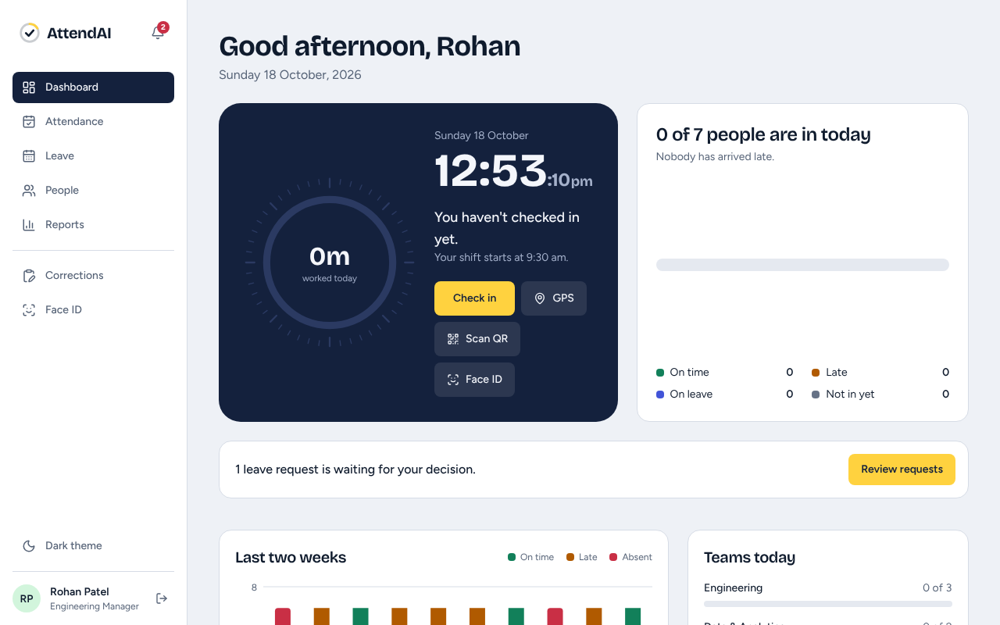
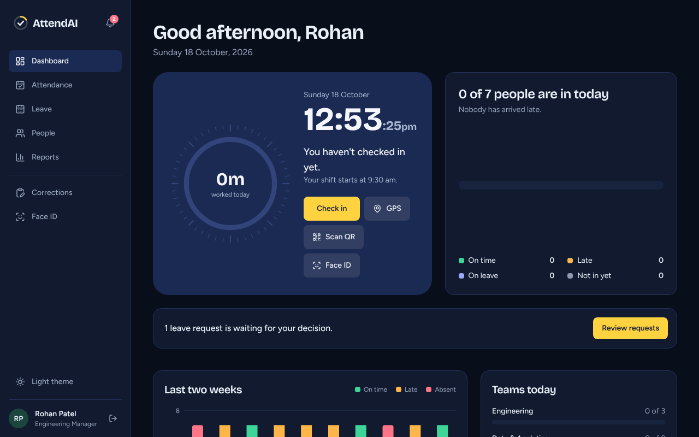
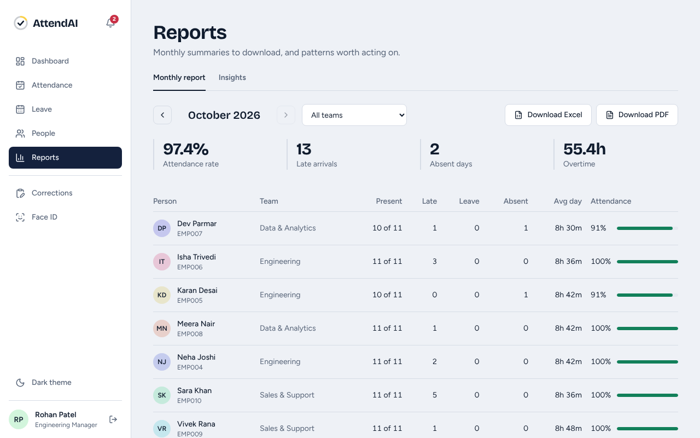
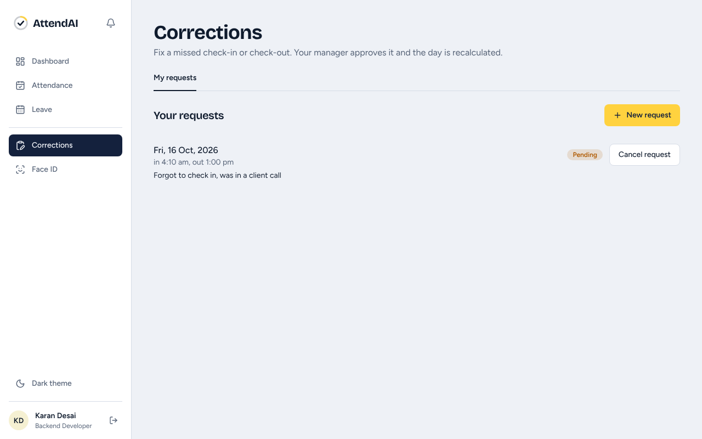
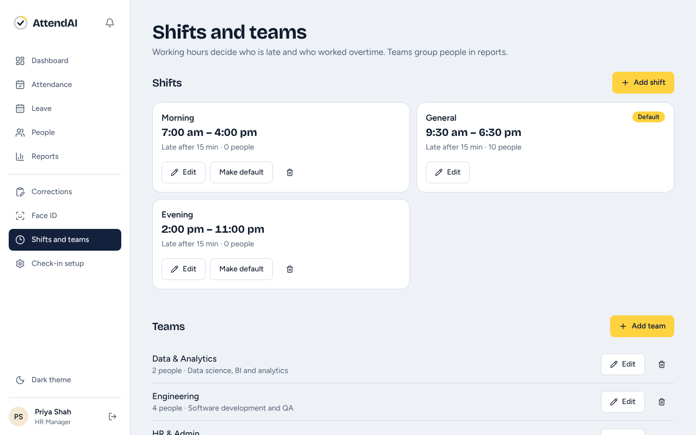

# AttendAI

Attendance and leave management for an IT company. Employees check in from a browser or phone, managers approve leave and watch the team, and HR gets monthly Excel and PDF reports plus pandas-driven insights.

**Stack:** React 19 + TypeScript + Tailwind 4 + Recharts, FastAPI + SQLAlchemy, PostgreSQL, pandas, openpyxl, reportlab. Designed for about 100 employees.

## Features

| Area | What it does |
|---|---|
| Roles | Admin, HR, Manager, Employee, enforced on the server (JWT) and reflected in the UI |
| Attendance | Check in / out, optional GPS check-in inside an office radius, late, early-leave and overtime from the employee's shift, monthly calendar |
| Leave | Apply (full or half day), cancel, balances per type, manager / HR approval with a note, weekends and holidays not charged |
| People | Add and edit employees, teams, reporting manager, shift, work mode (office / hybrid / WFH) |
| Holidays | Company holiday calendar that leave counting and reports use |
| Dashboard | Who is in today, two-week trend, teams today, searchable daily table |
| Reports | Monthly summary per person, Excel (live formulas, daily log, notes sheet) and PDF export |
| Insights | pandas analysis written as plain sentences: hardest weekday, team punctuality, overtime, trend, people worth a conversation |
| Corrections | Missed or wrong punch: employee asks with a reason, manager or HR approves, the day is recalculated and the change is noted on the record |
| Shifts and teams | HR creates, edits and deletes shifts (including night shifts that cross midnight) and teams in the app, with a guard against deleting one that is in use |
| Import people | Upload a CSV, preview what would happen, fix the rows with problems, then import |
| Account safety | Change your own password, HR can reset someone else's, wrong-password attempts are rate limited, all sign-in failures give one generic message |
| Check-in methods | Web, GPS, rotating QR and Face ID (see below) |
| Notifications | In-app bell plus email for leave, corrections, new accounts, password resets and Face ID changes |
| UI | Light and dark themes, phone layout with a bottom tab bar |

## Screenshots

| | | |
|---|---|---|
|  |  |  |
| Manager dashboard | Dark theme | Monthly report and insights |
|  |  |  |
| Missed-punch corrections | Shifts and teams | QR kiosk for the entrance |

On a phone: [dashboard](docs/screenshots/12-mobile-dashboard.png), [dark](docs/screenshots/15-mobile-dashboard-dark.png), [leave](docs/screenshots/14-mobile-leave.png). More in [`docs/screenshots`](docs/screenshots).

## Run it locally

You need Python 3.10+, Node 20.19+, PostgreSQL and Git.

```bash
# 1. Database
createdb -U postgres attendai
psql -U postgres -d attendai -f database/schema.sql

# 2. Backend
cd backend
python -m venv venv
venv\Scripts\activate            # Mac/Linux: source venv/bin/activate
pip install -r requirements.txt
copy .env.example .env           # Mac/Linux: cp .env.example .env  -> then put your DB password in .env
python -m scripts.seed           # 10 demo employees + 30 days of attendance
python -m scripts.seed_holidays  # fixed-date holidays for 2026 and 2027
uvicorn app.main:app --reload    # http://localhost:8000/docs

# 3. Frontend (new terminal)
cd frontend
npm install
npm run dev                      # http://localhost:5173
```

On Windows, `start_project.bat` starts both servers and opens the browser.

### Run the tests

```bash
createdb -U postgres attendai_test                       # an empty throwaway database: the tests wipe it
cd backend
pip install -r requirements-dev.txt
set TEST_DATABASE_URL=postgresql+psycopg2://postgres:<password>@localhost:5432/attendai_test   # Mac/Linux: export ...
cd tests && pytest -q                                     # 55 tests, about 20 seconds
```

They run on real PostgreSQL because the app depends on enums, arrays and constraints. The suite covers sign-in and roles, check-in rules (late, half day, night shift), leave balances and overlaps, corrections, shifts and teams, CSV import, QR expiry and tampering, Face ID matching and lockout, and email / notifications. GitHub Actions runs it plus the frontend build on every push (`.github/workflows/ci.yml`).

### Demo accounts (password `Demo@1234`)

`admin@attendai.com`, `hr@attendai.com`, `manager@attendai.com`, `neha@attendai.com` (employee). The sign-in page has one-click chips for each.

## Check-in methods

| Method | How it works | Honest limit |
|---|---|---|
| Web / GPS | Button on the dashboard. GPS must be inside the office radius. | GPS can be spoofed. |
| **QR** | HR opens **Check-in setup > QR kiosk** on a tablet at the entrance. It shows a code that changes every 45 seconds (HMAC-signed, no database writes). Staff scan it from the app. First scan checks in, the next checks out. | A photo of the code works until it expires. |
| **Face ID** | Staff enrol once (consent + password). The browser turns the face into 128 numbers (face-api); only the numbers are stored, never a photo. At check-in the server compares them, and the person must blink or turn their head first. If the camera can't see the movement, a "continue with face match only" button appears after 8 seconds. 5 wrong tries in 10 minutes locks it. | The movement check runs in the browser, so it is a hurdle, not proof against a determined attacker or a video. The fallback button skips it, so a photo of the person could pass. For a strict deployment, remove that button in `frontend/src/pages/Face.tsx`. |

Camera access needs **HTTPS or localhost**. Vercel and `npm run dev` are fine; a plain `http://192.168.x.x` address on a phone is not.

## Email and notifications

Every event creates an in-app notification (bell icon, refreshes every 30 s) and an email: leave requested, approved or rejected, new account, Face ID set up or removed.

- No `SMTP_HOST` in `backend/.env`: emails are **printed in the backend window** (test mode, nothing is sent).
- With SMTP settings (Gmail app password, Brevo, Resend and similar): real email. Set `APP_URL` so links in the mail open your site.
- `EMAIL_ENABLED=false` turns email off but keeps the bell.
- Emails are sent in the background, so a dead mail server never blocks or fails a request. HR can press **Send me a test email** in Check-in setup and sees the real error if it fails.

## Project layout

```
database/schema.sql      13 tables, enums, indexes, a reporting view, seed rows
docs/                    ER diagram, API reference, interview guide, deployment guide
backend/app/
  main.py                app, CORS, router registration
  database.py            settings, engine, session
  models.py schemas.py   ORM models and request / response shapes
  security.py            bcrypt, JWT, require_roles()
  routers/               auth, employees, attendance, leave, corrections, org (shifts + teams), holidays, reports, analytics, qr, face, notifications
  throttle.py            small in-memory rate limiter for sign-in and password attempts
  emailer.py notify.py   email (console / SMTP / off) and in-app notifications
backend/tests/           pytest suite (real PostgreSQL)
backend/scripts/         seed.py, seed_holidays.py
frontend/src/
  pages/                 Login, Dashboard, Attendance, Leave, Corrections, Organisation, Profile, Employees, Reports, Scan, Kiosk, Face, Settings
  components/            UI kit, check-in card, dial, charts, layout
  lib/ context/ hooks/   API client, formatters, face + blink detection, auth + theme, camera hook
frontend/public/models/  face-api model files (about 7 MB, loaded only on the Face ID page)
```

## Documentation

- [API reference](docs/API.md), also live at `/docs` (Swagger) when the backend runs
- [Database design and ER diagram](docs/ER_DIAGRAM.md)
- [Interview guide](docs/INTERVIEW_GUIDE.md)
- [Deployment guide](docs/DEPLOYMENT.md)

## Known limits

- Face ID liveness (blink or head turn) runs in the browser. It stops a held-up photo, not a video of the person, and the "face match only" fallback skips it. See *Check-in methods*
- A QR code can be photographed and replayed inside its 45-second life, so pair it with Face ID or GPS where that matters
- Rate limits and Face ID lockouts are counted in memory in one server process. A bigger deployment would move them to Redis
- Emails are sent in a background task, not a job queue, so a server restart can lose one that was just queued
- No password reset by email link yet: HR resets a password and tells the person
- Insights are rule-based statistics, not a machine-learning model
