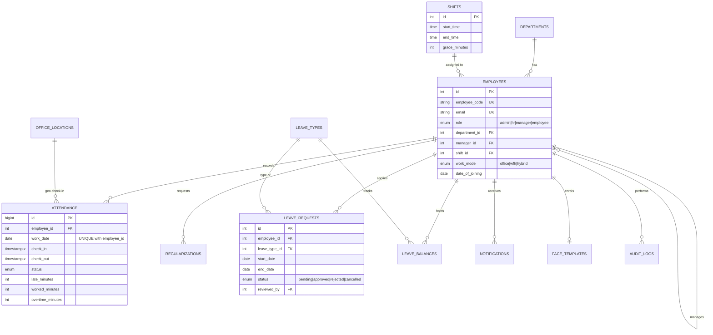

# AttendAI - Database Design

## Interview talking points
- **One row per employee per day** (`UNIQUE(employee_id, work_date)`) prevents duplicate check-ins at the database level, not just in code.
- **Employees table doubles as login accounts**, with a role enum driving role-based access (Admin, HR, Manager, Employee).
- **Self-referencing `manager_id`** gives the approval chain for leave and attendance corrections.
- **Shift rules live in data** (grace, half-day, full-day minutes), so late and overtime logic needs no code change per shift.
- **`CHECK` constraints** guard data integrity (`end_date >= start_date`, `check_out >= check_in`).
- **Indexed for the common queries**: daily attendance by date, per-employee history, pending leave by employee.
- **`v_monthly_attendance_summary` view** feeds the dashboard and Excel/PDF reports, and the pandas analytics later.
- **Audit log with JSONB details** records who changed what.
- **`face_templates` stores 128 numbers, not images**, one row per employee (`UNIQUE employee_id`), with the consent time. Deleting the employee cascades to it. `check_method` gained `qr` and `face`.
- **`notifications` has an optional `link`**, so a bell item can open the leave page directly.
